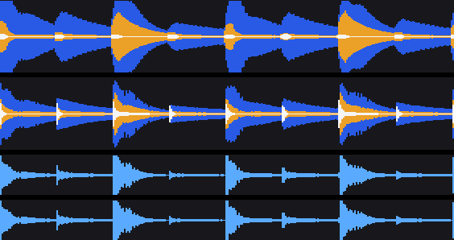
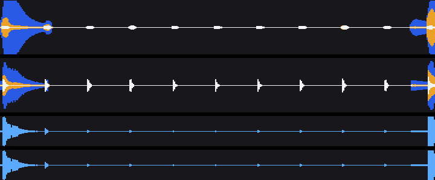

# Three-band waveform precision: Ord vs rbxport vs rekordbox

Status: finding + proposed change, not yet implemented. Written 2026-11-06
from a cloud session with no audio or reference sticks; the verification
plan at the end runs on the laptop, where `testdata/rekordbox-reference`
lives.

## Finding

The exported scrolling waveforms are the same resolution as rekordbox's
(150 columns/s, exact per-sample column assignment) and the **mono** one
(`PWV3`/`PWV5` height) matches rbxport column for column. The loss of
precision is in the **three-band** waveform (`PWV7`, and `PWV5`'s colour):
Ord smears transients that rekordbox and rbxport keep sharp.

Same synthetic 128 BPM signal (kick, off-beat sub, hats every 8th, a stab
on 2 and 4, a two-second hats-only breakdown) through both tools' actual
analysis code. Lanes top to bottom: Ord 3-band, rbxport 3-band, Ord mono,
rbxport mono.





Measured on that signal (band values 0–127):

| | Ord | rbxport |
| --- | ---: | ---: |
| Kick width, low band > 64 | 15.6 columns (104 ms) | 6.1 columns (41 ms) |
| High band peak | 9 | 48 |
| High band p95 | 7 | 18 |
| Low band p95 | 127 (saturated) | 90 |
| Mono height (`PWV3`) columns differing | 33 of 1200, by one step | |

Hats are invisible in Ord's band waveform and are white ticks in
rbxport's; the breakdown render shows it directly.

## Why

`ordnung-core/src/analysis/waveform.rs::scroll_bands` takes the **RMS** of
each band per column, then smooths it over **±2 columns** (`SCROLL_SMOOTH`,
33 ms), normalises to the loudest smoothed column and applies per-band
gains `SCROLL_GAIN = [1.4, 2.2, 0.75]`.

- RMS over a 6.7 ms column plus a 33 ms centred window spreads every hit
  over five columns.
- The 1.4 low gain pushes a kick's columns to a saturated 127 block.
- RMS and the 0.75 high gain flatten a 20 ms hat burst to single digits.

rbxport (`crates/rbl-analysis/src/waveform.rs::compute`, commit b739d36)
takes the **per-column peak** of each one-pole band-filtered signal
(crossovers 200 Hz / 2 kHz), no smoothing, no gains, and writes `band >> 1`
into `PWV7`. Its calibration notes (`docs/reference/waveform-analysis.md`)
say that matches rekordbox's own `PWV7` envelope at r ≥ 0.97 on nine real
tracks. Ord's suite reports a median r of 0.912 on 94 reference tracks
(`anlz.rs`, `BAND_LAG`), and found rekordbox's bands "matched better
shifted one column later", which is what a centred smoothing window looks
like next to an unsmoothed envelope.

## Proposed change

One function. In `scroll_bands`:

1. Per band, keep the column's **peak absolute value** of the filtered
   signal instead of the sum of squares.
2. Drop the ±`SCROLL_SMOOTH` smoothing pass.
3. Drop `SCROLL_GAIN`; normalise each band to the track's loudest band
   column as today (or to 1.0 full scale like rbxport; the suite decides).
4. Remove `BAND_LAG` in `anlz.rs` if the suite's shift test no longer
   prefers it.

Keep the biquad band split, `amp`/`peak`/`rms` columns, `PWV3`/`PWV5`
height, `PWV5` colour normalisation and `PWV6` as they are. The in-app zoom
lane (`player.rs::compute_hires_bands`, 2000 bins/s, peak-based) is not
affected.

Caveats: the evidence above is one synthetic signal, and rbxport's
rekordbox match is its own claim. The change must be judged on the
reference sticks, not on this page.

## Verification on the laptop

```sh
make rb-suite NAME=<reference> LEG=analysis   # before: note "waveforms … median r" for PWV7/PWV5
# apply the change
make rb-suite NAME=<reference> LEG=analysis   # after: PWV7 median r and level must not drop; expect r to rise
```

Then export a stick, load it on a CDJ or in rekordbox next to the same
track analysed by rekordbox, and look at a kick and a hat run at the
tightest zoom. If it holds, bump `ANALYZER_VERSION` only if the cached
analysis carries these columns (the export recomputes them from audio
today, so it should not), and release as a PATCH.

## Prompt for the laptop session

Paste this into a Claude Code session in the Ord worktree on the Mac:

> Read `docs/design/waveform-bands/README.md`. Implement the proposed
> change to `scroll_bands` in `crates/ordnung-core/src/analysis/waveform.rs`
> exactly as described, keeping everything else in the writer as is. Before
> touching code, run `make rb-suite LEG=analysis` on every reference under
> `testdata/rekordbox-reference` and record the PWV7 and PWV5 "median r"
> and "median level" lines. Apply the change, update the unit tests in
> `waveform.rs` that assert on smoothing or gains, rerun the suite, and
> report before/after per reference. If PWV7 r rises on most references and
> level stays within the suite's tolerance, also check whether `BAND_LAG`
> in `crates/ordnung-rbdb/src/anlz.rs` still helps; remove it if not. Then
> export one stick, verify on hardware or in rekordbox per the doc, commit
> with what was reused, and release as a PATCH per the `release` skill. If
> r drops, do not push; write what you saw at the end of the doc instead.
