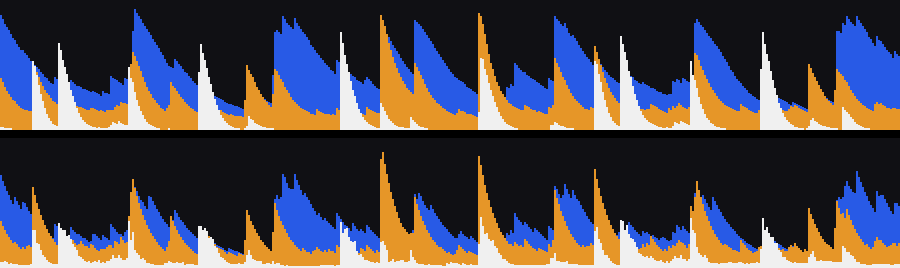
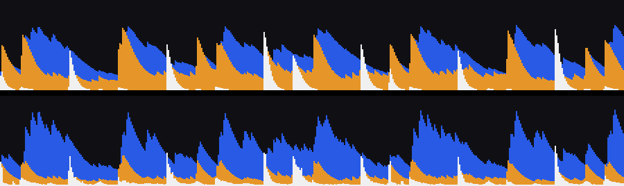

# Three-band waveform: how Ord's bands match rekordbox's

Status: shipped 2026-11-06. Measured on the `stop126` reference (94
tracks rekordbox 7 analysed itself) with `make rb-suite NAME=stop126
LEG=mirror`, which scores every exported waveform section against
rekordbox's own file by shape (Pearson r ≥ 0.85) and level (mean, ours ÷
rekordbox's, within 0.8–1.25).

## Finding

The mono scrolling waveform (`PWV3`/`PWV5` height) already matched (92 of
94). The three-band waveform (`PWV7`, and `PWV5`'s colour) did not: 50 of
94 within tolerance, median r 0.917, and the writer had to shift our bands
one column late to get even that.

Rendering rekordbox's `PWV7` columns next to ours showed why. rekordbox's
bands are an envelope follower: an instant attack to the band's peak, then
a steady exponential release. A kick is a sawtooth about sixteen columns
long in the low band; a hi-hat is a single white column. Ord took the RMS of
each band per column, smoothed it over ±2 columns and applied per-band
gains, which smeared every hit over five columns and sank hats to single
digits.

A plain per-column peak (no release) was worse than the RMS: it is jagged,
because a 50 Hz bass cycle is longer than a 6.7 ms column, so the low band
dipped between cycles (r 0.871, 37 of 94).

## What shipped

`ordnung-core/src/analysis/waveform.rs::scroll_bands` keeps the biquad
band split at 200 Hz / 2 kHz and takes each band's **per-column peak**,
held through a per-band release (`SCROLL_RELEASE`, larger of the column's
own peak and the previous value × factor) and a per-band level trim
(`SCROLL_GAIN`):

| band | release per column | gain |
| --- | ---: | ---: |
| low | 0.94 | 1.15 |
| mid | 0.90 | 1.10 |
| high | none | 0.80 |

Both tables came from a fit of eight reference tracks' rekordbox columns
against our raw peak columns (release grid 0.88–0.95 and none, lag 0 or 1).
No lag won on every band, so `BAND_LAG` in `ordnung-rbdb/src/anlz.rs` is
gone.

Rekordbox above, Ord below, 3 s at 150 columns/s:

## Result on all 94 tracks

| section | before | after |
| --- | --- | --- |
| `PWV7` within tolerance | 50/94, r 0.917, level 1.21 | 75/94, r 0.965, level 1.03 |
| `PWV6` within tolerance | 9/94, r 0.729 | 11/94, r 0.784 |
| `PWV3`, `PWV5`, `PWAV`, `PWV2`, `PWV4` | unchanged | unchanged |

Remaining gap: some tracks' mid band comes out lower than rekordbox's (Yding
above), so rekordbox's mid crossover may sit lower than 200 Hz or its filters
may be shallower. `PWV6` (the 1200-column preview) is still mostly outside
tolerance; it is derived from these columns with its own scale and wants
its own fit.

Verified in the app by browsing the exported stick and rekordbox's own stick
side by side: the row waveforms read the same.
